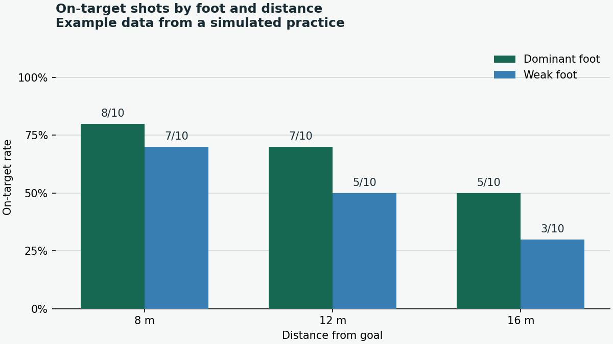

# Soccer Shot Tracker

I played three seasons of varsity soccer and wanted to build something around a question I’d actually ask during practice. How much does my on-target rate change as I move farther from goal or switch to my weak foot?

The tracker saves one row per shot. It groups shots by distance and foot, then shows the on-target rate and the number of attempts. I want the counts there because 2 out of 2 tells a different story from 20 out of 20.

## Example chart



The repository starts with **simulated practice data**. In the example, the weak foot went from 7 of 10 on target at 8 metres to 3 of 10 at 16 metres. That shows how I’ll read the chart once I have my own sessions recorded.

## Try it

With Python 3.12 and an active virtual environment, install Matplotlib and generate the example chart.

```bash
python -m pip install -r requirements.txt
python shots.py chart data/example_shots.csv
```

## Record a practice

Take the same number of shots with each foot at 8, 12, and 16 metres. Use the same goal and shooting angle across the drill. Count a shot as on target if it would go into the goal. Use `1` for on target and `0` for off target.

```bash
python shots.py add data/my_shots.csv --distance 12 --foot weak --on-target 1
python shots.py add data/my_shots.csv --distance 12 --foot dominant --on-target 0
python shots.py chart data/my_shots.csv
```

The `add` command uses today’s date by default. For an earlier session, pass `--session YYYY-MM-DD`. You can also keep the same four columns in a spreadsheet and export a CSV. The chart and summary tell me where to look first. Repeating the same drill on different days will help me see whether a pattern holds.
